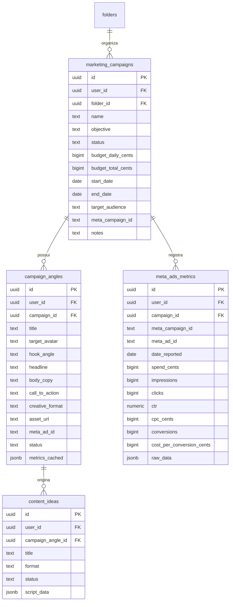
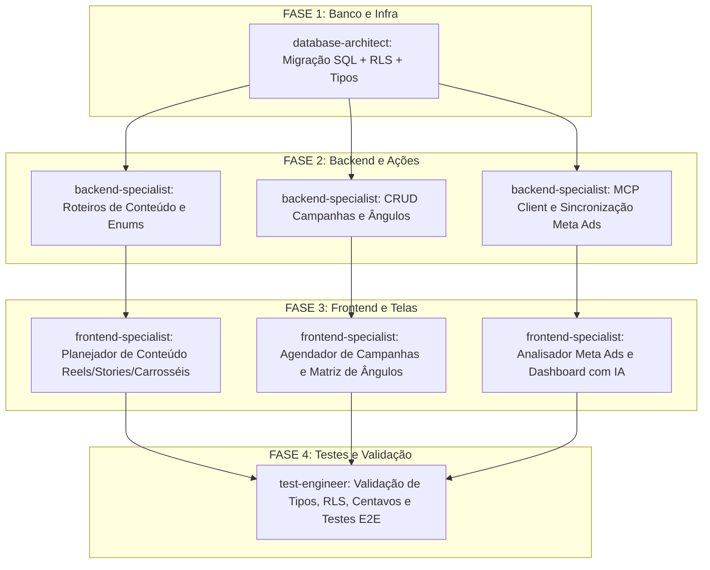

# Plano Executivo: Diretoria de Marketing Trust Care

> **Projeto:** Segundo Cérebro (Luan — Trust Care)  
> **Status:** Proposta de Planejamento Executivo  
> **Responsável pelo Planejamento:** `project-planner`  
> **Data:** Novembro de 2026  
> **Ambiente:** Next.js 16 (App Router, React 19, Server Actions, Tailwind CSS v4, shadcn/ui), Supabase (PostgreSQL + RLS estrita), Porta 3333, Fuso Cuiabá (UTC-4), Valores monetários em centavos.

---

## 1. Visão Geral e Objetivos de Negócio

A **Trust Care** atua com serviços de alta confiança técnica em Cuiabá e Várzea Grande: manutenção avançada de computadores, reparo de placas, upgrades de alta performance e revenda de notebooks seminovos revisados.

A **Diretoria de Marketing** surge dentro do Segundo Cérebro como a central executiva de crescimento da empresa, resolvendo três gargalos essenciais do Luan:
1. **Fim do bloqueio criativo e da desorganização de postagens:** Criação guiada e estruturada de formatos com alta conversão no Instagram (Reels dinâmicos, sequências diárias de Stories e Carrosséis educativos/comerciais).
2. **Previsibilidade e testes científicos de tráfego:** Agendamento cronológico de campanhas de anúncios (Meta Ads) com uma **Matriz de Ângulos**, permitindo testar sistematicamente qual dor ou desejo converte mais clientes (ex.: PC lento vs. Upgrade econômico vs. Segurança).
3. **Clareza de retorno e tomada de decisão via dados:** Integração com o ecossistema Meta Ads via MCP (Model Context Protocol), trazendo métricas reais (gasto, impressões, cliques, CTR, CPC, leads gerados) para dentro do sistema, com diagnósticos sugeridos por IA para otimizar o orçamento.

---

## 2. Arquitetura e Estrutura de Telas e Pastas

### 2.1 Integração com a Navegação do Segundo Cérebro
Na árvore lateral do sistema, dentro da área **Trust Care** (`area_id` da Trust Care, cor `#EA580C`), será criada a pasta raiz:
- 🏢 **Diretoria de Marketing** (`module = "marketing_director"`, ícone `"megaphone"` ou `"trending-up"`).

Ao clicar nesta pasta em `/p/[folderId]`, o usuário acessa o **Hub da Diretoria de Marketing**, estruturado em três grandes abas contextuais:
1. 📝 **Planejador de Conteúdo:** Roteirização visual para Reels, Stories e Carrosséis integrados ao calendário de publicações.
2. 🎯 **Campanhas & Matriz de Ângulos:** Linha do tempo de campanhas de anúncios com matriz de teste de ângulos de comunicação.
3. 📊 **Analisador Meta Ads:** Painel executivo de métricas com sincronização via MCP Meta Ads e diagnóstico consultivo com IA.

### 2.2 Estrutura de Arquivos no Projeto

```
c:\projetos\segundo-cerebro\
├── app\
│   └── (app)\
│       └── p\
│           └── [folderId]\
│               └── page.tsx                         # Registra o módulo 'marketing_director'
├── components\
│   └── trustcare\
│       └── marketing\
│           ├── marketing-director-hub.tsx            # Componente de controle das abas principais
│           ├── meta.ts                              # Constantes, tipos, formatos e status
│           ├── content-planner\
│           │   ├── content-planner-board.tsx         # Visão geral de conteúdos por formato e funil
│           │   ├── reel-script-sheet.tsx            # Editor de roteiro para Reels (Gancho, Retenção, CTA)
│           │   ├── story-sequence-sheet.tsx         # Sequenciador em 4 atos para Stories
│           │   └── carousel-builder-sheet.tsx       # Construtor slide a slide para Carrosséis
│           ├── campaigns\
│           │   ├── campaigns-timeline.tsx           # Visão cronológica/calendário de campanhas
│           │   ├── campaign-dialog.tsx              # Criação/edição de campanha (budget, datas, meta)
│           │   ├── angles-matrix.tsx                # Matriz comparativa de ângulos de criativos
│           │   └── angle-dialog.tsx                 # Editor de ângulo (Avatar, Dor/Gancho, Copy, CTA)
│           └── ads-analyzer\
│               ├── ads-analyzer-dashboard.tsx       # Painel de KPIs (Spend, CTR, CPC, Leads, CPA)
│               ├── angle-performance-table.tsx      # Tabela comparativa de performance por ângulo
│               ├── mcp-sync-card.tsx                # Gatilho de sincronização via MCP Meta Ads
│               └── ai-campaign-diagnostics.tsx      # Painel lateral com parecer e recomendações da IA
├── lib\
│   ├── modules.ts                                   # Registro do módulo 'marketing_director'
│   ├── actions\
│   │   ├── marketing-content.ts                     # Server Actions para roteiros estruturados
│   │   ├── marketing-campaigns.ts                   # Server Actions para campanhas e ângulos
│   │   └── meta-ads-sync.ts                         # Server Action que dispara o MCP / API Meta Ads
│   ├── data\
│   │   └── marketing.ts                             # Consultas Supabase (Campanhas, Ângulos, Métricas)
│   └── integrations\
│       └── meta-ads\
│           ├── types.ts                             # Tipagens de insights e campanhas do Meta Ads
│           ├── mcp-client.ts                        # Bridge cliente para MCP Meta Ads
│           └── direct-api.ts                        # Fallback seguro para Graph API do Meta
└── supabase\
    └── migrations\
        └── 20261102140000_marketing_director.sql    # Tabelas, enums, triggers, RLS e índices
```

---

## 3. Modelo de Dados e Migrações (Supabase PostgreSQL com RLS)

Todas as novas tabelas respeitam estritamente as regras de arquitetura do projeto:
- `user_id uuid not null default auth.uid() references auth.users(id) on delete cascade`
- `created_at`, `updated_at`, `deleted_at` para soft delete
- Dinheiro armazenado em **centavos** (`bigint`)
- Ativação de RLS com `select private.apply_owner_policy('public.nome_tabela');`
- Verificação final obrigatória: `select private.assert_rls_enabled();`



### 3.1 Tabela `public.marketing_campaigns`
Representa as campanhas de marketing estruturadas no tempo:
- `id` (uuid, PK)
- `user_id` (uuid, FK auth.users)
- `folder_id` (uuid, FK folders, nullable)
- `name` (text, not null) — Ex: "Campanha Upgrade Turbo Final de Ano"
- `objective` (text, not null) — `whatsapp_leads`, `brand_awareness`, `upgrades_maintenance`, `notebook_sales`, `custom`
- `status` (text, not null default 'draft') — `draft`, `scheduled`, `active`, `paused`, `completed`, `archived`
- `budget_daily_cents` (bigint default 0) — Orçamento diário em centavos
- `budget_total_cents` (bigint default 0) — Orçamento total previsto em centavos
- `start_date` (date, not null) — Data de início
- `end_date` (date) — Data de término prevista
- `target_audience` (text) — Ex.: "Cuiabá e VG, 22-55 anos, profissionais liberais, gamers e estudantes"
- `meta_campaign_id` (text) — ID no gerenciador do Meta Ads para sincronização
- `notes` (text)
- `created_at`, `updated_at`, `deleted_at`

### 3.2 Tabela `public.campaign_angles`
Permite documentar, comparar e testar diferentes ângulos comunicacionais para a mesma campanha:
- `id` (uuid, PK)
- `user_id` (uuid, FK auth.users)
- `campaign_id` (uuid, FK marketing_campaigns on delete cascade)
- `title` (text, not null) — Ex: "Ângulo: Dor do Computador Travando no Home Office"
- `target_avatar` (text) — Ex: "Advogado / Contador com PC de 8GB travando planilhas"
- `hook_angle` (text, not null) — `dor_urgencia`, `custo_beneficio`, `prova_social`, `autoridade_tecnica`, `oportunidade`
- `headline` (text) — Ex: "Seu notebook demora 5 minutos para ligar todo dia?"
- `body_copy` (text) — Roteiro / texto base do anúncio
- `call_to_action` (text) — Ex: "Chame no WhatsApp e receba um diagnóstico gratuito"
- `creative_format` (text) — `video_reel`, `carousel`, `single_image`, `story`
- `asset_url` (text) — Link do Google Drive / Storage com o vídeo ou arte final
- `meta_ad_id` (text) — ID do anúncio correspondente no Meta Ads
- `status` (text, default 'draft') — `draft`, `testing`, `winner`, `paused`, `discarded`
- `metrics_cached` (jsonb, default '{}') — Cache consolidado: `{ "spend_cents": 15000, "clicks": 85, "ctr": 2.4, "cpc_cents": 176, "leads": 12, "cpl_cents": 1250 }`
- `created_at`, `updated_at`, `deleted_at`

### 3.3 Evolução de `content_ideas` e Suporte a Roteiros Avançados
Melhoria na tabela existente `public.content_ideas`:
- Adição da coluna `campaign_angle_id` (uuid, FK campaign_angles on delete set null): conecta o conteúdo orgânico a um ângulo de campanha de anúncio.
- Adição da coluna `script_data` (jsonb not null default '{}'::jsonb): armazena o formato rico do roteiro:
  - **Reels:**
    ```json
    {
      "type": "reel",
      "hook_3s": "Você sabia que 90% dos PCs lentos não precisam ser trocados?",
      "retention_body": ["Mostrar abertura do notebook", "Destacar poeira e pasta térmica seca", "Mostrar instalação do SSD NVMe"],
      "cta": "Mande uma mensagem agora para orçar seu upgrade sem custo.",
      "audio_suggestion": "Áudio em alta / instrumental dinâmico",
      "duration_seconds": 45
    }
    ```
  - **Stories (Sequência em 4 quadros):**
    ```json
    {
      "type": "story",
      "frames": [
        { "number": 1, "goal": "Contexto", "text": "Chegou esse Dell Inspiron hoje no laboratório...", "interactive_element": "Enquete: O seu PC já travou essa semana?" },
        { "number": 2, "goal": "Diagnóstico", "text": "Olha a situação da placa e pasta térmica ressecada.", "interactive_element": "Foto com seta" },
        { "number": 3, "goal": "Solução", "text": "Limpeza química + upgrade de memória e SSD feito com sucesso.", "interactive_element": "Vídeo rápido" },
        { "number": 4, "goal": "CTA", "text": "Quer deixar seu notebook novo de novo? Responda aqui.", "interactive_element": "Caixinha / Link WhatsApp" }
      ]
    }
    ```
  - **Carrosséis (Slide a slide):**
    ```json
    {
      "type": "carousel",
      "slides": [
        { "index": 1, "role": "capa", "headline": "5 Sinais de que seu notebook vai pifar em breve", "visual_cue": "Foto dramática de tela azul" },
        { "index": 2, "role": "conteudo", "headline": "1. Superaquecimento e barulho excessivo", "visual_cue": "Close no cooler entupido" },
        { "index": 3, "role": "conteudo", "headline": "2. Lentidão anormal ao abrir abas", "visual_cue": "Gráfico de uso de memória em 100%" },
        { "index": 4, "role": "cta", "headline": "Salve este post e traga seu equipamento na Trust Care!", "visual_cue": "Logo Trust Care e contato" }
      ]
    }
    ```

### 3.4 Tabela `public.meta_ads_metrics`
Armazena os relatórios consolidados vindos via MCP / Meta Ads API para análise histórica e gráficos rápidos sem bater no rate limit da Meta:
- `id` (uuid, PK)
- `user_id` (uuid, FK auth.users)
- `campaign_id` (uuid, FK marketing_campaigns on delete set null)
- `meta_campaign_id` (text, not null)
- `meta_ad_id` (text)
- `date_reported` (date, not null)
- `spend_cents` (bigint not null default 0)
- `impressions` (bigint not null default 0)
- `clicks` (bigint not null default 0)
- `ctr` (numeric(5,2) not null default 0)
- `cpc_cents` (bigint not null default 0)
- `conversions` (bigint not null default 0) — Ex.: Leads / Mensagens iniciadas no WhatsApp
- `cost_per_conversion_cents` (bigint not null default 0)
- `raw_data` (jsonb default '{}')
- `created_at` (timestamptz default now())

---

## 4. Integração do MCP Meta Ads

### 4.1 O que é e Como Funciona
O **Model Context Protocol (MCP)** do Meta Ads permite que o agente Antigravity e as Server Actions consultem de forma padronizada a API de Marketing da Meta.

A integração será estruturada em `lib/integrations/meta-ads/`:
1. **Configuração MCP em `.agents/mcp_config.json`:**
   Adição do servidor MCP do Meta Ads configurado com as credenciais da conta de anúncios da Trust Care.
2. **Bridge de Execução Segura (`lib/integrations/meta-ads/mcp-client.ts`):**
   Mecanismo para executar as ferramentas MCP:
   - `meta_get_campaign_insights`: Busca gasto, impressões, cliques, CTR, CPC e conversões dos últimos 7, 14 ou 30 dias.
   - `meta_get_ad_creatives`: Recupera os criativos e copies ativos no gerenciador.
3. **Fallback Resiliente:**
   Caso o MCP local não esteja ativo no momento da execução pelo browser, a Server Action utiliza a Graph API direta da Meta com tokens seguros guardados no servidor (`META_ACCESS_TOKEN`, `META_AD_ACCOUNT_ID`), garantindo funcionamento 100% autônomo.
4. **Análise Consultiva com Gemini (`analyzeCampaignPerformanceWithAi`):**
   Com os dados consolidados, a IA do Google Gemini (configurada em `lib/ai.ts`) recebe o histórico de métricas e os ângulos criados para responder de forma executiva:
   - Qual ângulo obteve o menor custo por lead de WhatsApp.
   - Recomendações de pausa para anúncios com CTR < 1.0%.
   - Sugestão de aumento de verba para os ângulos vencedores.

---

## 5. Divisão de Tarefas por Agentes Especializados

Para a fase de execução paralela, o trabalho é distribuído entre quatro especialistas com fronteiras bem delimitadas:



### Agente 1: `database-architect`
- **Escopo:**
  1. Criar o arquivo de migração `supabase/migrations/20261102140000_marketing_director.sql`.
  2. Implementar as tabelas `marketing_campaigns`, `campaign_angles`, `meta_ads_metrics` e as alterações em `content_ideas`.
  3. Configurar RLS estrita com `select private.apply_owner_policy(...)`.
  4. Criar gatilhos de `set_updated_at` e índices de chave estrangeira com `select private.index_foreign_keys()`.
  5. Inserir a pasta semente "Diretoria de Marketing" no script de seed da Trust Care.
  6. Regenerar as tipagens do banco em `lib/supabase/database.types.ts`.

### Agente 2: `backend-specialist`
- **Escopo:**
  1. Registrar o módulo `marketing_director` em `lib/modules.ts`.
  2. Criar `lib/data/marketing.ts` com funções de consulta tipadas: `getCampaigns`, `getCampaignById`, `getCampaignAngles`, `getMetaAdsMetrics`.
  3. Criar `lib/actions/marketing-campaigns.ts`: Server Actions para criar, editar, pausar e arquivar campanhas e ângulos, com validação Zod (orçamento em centavos, datas em padrão ISO).
  4. Criar `lib/actions/marketing-content.ts`: Server Actions para salvar roteiros estruturados de Reels, Stories e Carrosséis em `content_ideas`.
  5. Criar `lib/integrations/meta-ads/` e `lib/actions/meta-ads-sync.ts`: rotina de sincronização de métricas e endpoint consultivo de IA para diagnósticos de tráfego.

### Agente 3: `frontend-specialist`
- **Escopo:**
  1. Implementar o container mestre `components/trustcare/marketing/marketing-director-hub.tsx` e integrá-lo em `app/(app)/p/[folderId]/page.tsx`.
  2. Criar a tela do **Planejador de Conteúdo**:
     - Visualizador em abas/cartões por formato (Reels, Stories, Carrosséis).
     - Formulário rico para Reels (Gancho 3s, Roteiro, Áudio, CTA).
     - Sequenciador de Stories (Frames 1 a 4 com suporte a elementos interativos).
     - Construtor de Carrosséis (Slides 1 a N com visualização prévia).
  3. Criar a tela de **Agendamento de Campanhas & Ângulos**:
     - Timeline cronológica das campanhas ao longo dos meses.
     - Modal de nova campanha com orçamento formatado em BRL (R$ 0,00 → centavos).
     - Matriz de Ângulos (cards lado a lado com avatar, dor/gancho, copy e status "vencedor/em teste").
  4. Criar o painel do **Analisador Meta Ads**:
     - Grid de métricas de destaque (Investimento Total, Cliques, CTR Médio, CPC, Conversões WhatsApp, CPL).
     - Tabela detalhada comparando o desempenho real por ângulo.
     - Botão "Sincronizar Meta Ads (MCP)" com feedback em tempo real.
     - Painel lateral com parecer da IA Gemini sobre as campanhas.

### Agente 4: `test-engineer`
- **Escopo:**
  1. Validar rigorosamente os tipos TypeScript em todo o workspace (`npx tsc --noEmit`).
  2. Executar `npm run lint` para garantir zero violações de formatação ou convenções.
  3. Verificar isolamento de RLS: confirmar que nenhum dado vaza entre usuários.
  4. Testar consistência monetária: garantir que todos os valores de orçamento e métricas trafeguem em centavos e nunca sofram arredondamento de ponto flutuante.
  5. Confirmar preservação do fuso horário de Cuiabá nas datas de início e fim de campanhas.

---

## 6. Critérios de Aceitação

| Módulo | Critério de Aceitação |
|---|---|
| **Hub Diretoria de Marketing** | Ao acessar a pasta "Diretoria de Marketing" na barra lateral da Trust Care, a tela carrega com abas responsivas e tema visual alinhado à cor laranja da Trust Care (`#EA580C`). |
| **Planejador de Conteúdo** | É possível redigir e salvar um roteiro completo de Reel (gancho + desenvolvimento + CTA), uma sequência de Stories em quadros e um Carrossel slide a slide. Os dados persistem no banco e aparecem vinculados ao calendário de publicações. |
| **Agendamento de Campanhas** | É possível criar uma campanha com data de início e fim, objetivo e orçamento em reais (convertido para centavos). A campanha é exibida na linha do tempo cronológica. |
| **Planejador de Ângulos** | É possível cadastrar múltiplos ângulos sob uma mesma campanha (ex.: Ângulo Dor vs. Ângulo Custo-Benefício) com headlines e copys distintas e marcar um ângulo como "Vencedor". |
| **Analisador Meta Ads** | Ação de sincronização busca as métricas (reais ou simuladas via MCP Mock) e atualiza os cards de Spend, CTR, CPC e Leads. O botão de diagnóstico de IA devolve um resumo executivo com recomendações. |
| **Segurança e RLS** | Nenhuma tabela nova permite consulta ou escrita sem autenticação. O comando `select private.assert_rls_enabled();` roda com sucesso sem exceções. |
| **Qualidade de Código** | Build do Next.js sem erros e TypeScript sem warnings nas rotas e componentes criados. |

---

## 7. Próximos Passos Imediatos

1. Apresentar este plano ao usuário (Luan) para validação de escopo.
2. Com a aprovação, disparar a execução paralela dos agentes:
   - Primeiro: `database-architect` (migração e banco).
   - Em seguida: `backend-specialist` + `frontend-specialist` em paralelo.
   - Por fim: `test-engineer` (validação ponta a ponta e testes de integridade).
